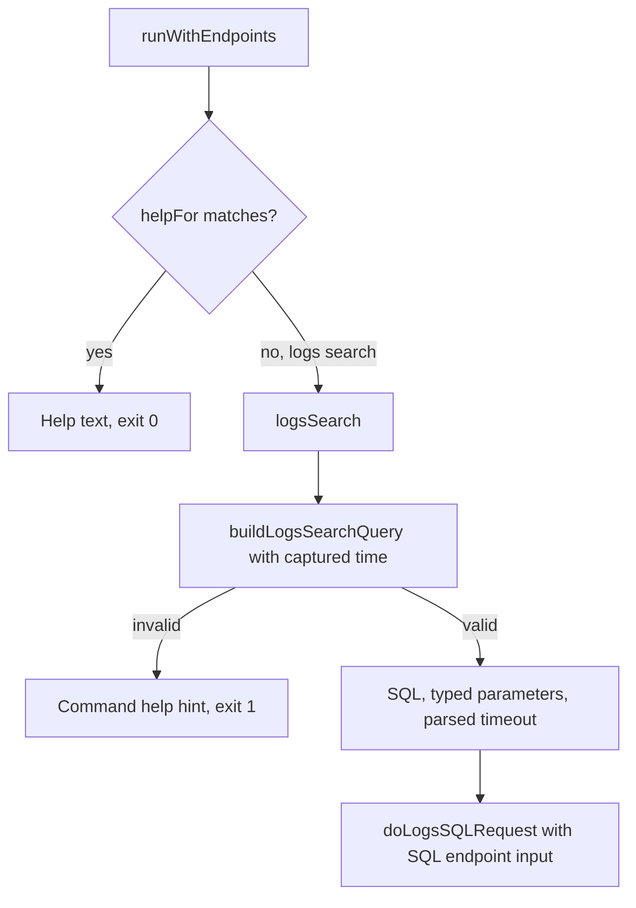
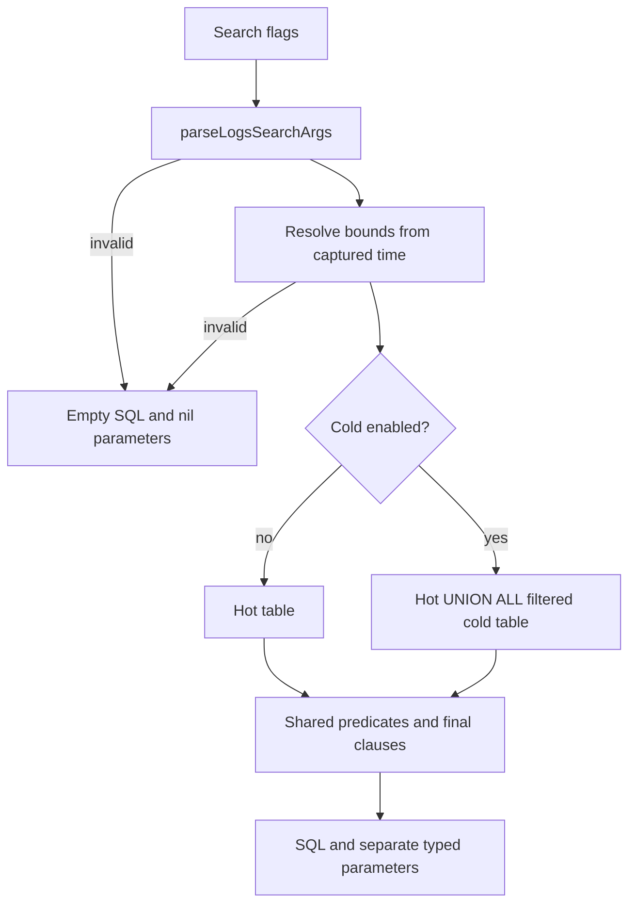
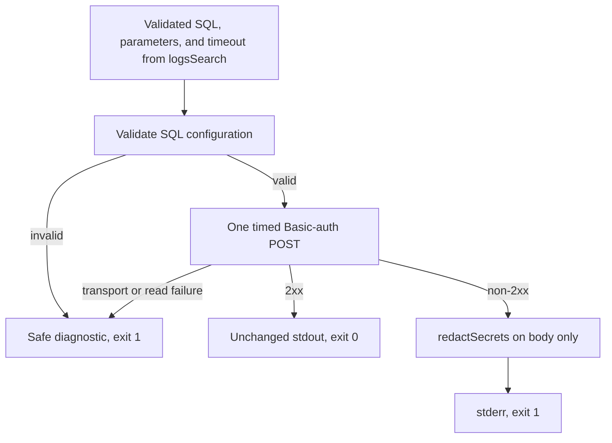

# Telemetry log search

## Command routing and help

[runWithEndpoints](../../cmd/bs/main.go) checks `helpFor` before routing `bs logs search` to `logsSearch`. The handler calls `buildLogsSearchQuery` with one captured current time, then passes SQL, typed parameters, and the parsed timeout to `doLogsSQLRequest`. Invalid flags or bounds produce a command-specific `bs logs search --help` hint and exit 1 before SQL configuration or requests. `bs logs` and unknown actions use the established resource diagnostics. `runWithAPI` preserves its signature and supplies an empty SQL injection input, so production SQL uses the configured URL.

Exact root, logs resource, and logs search help returns without credentials or HTTP access. [Command help](../../cmd/bs/help.go) documents all flags, the full `t<team_id>_<table_name>` identifier, and that `bs sources get <id>` shows both parts. The argument after `--query` is data, including option-shaped text: `--query --cold` does not enable cold storage. `--cold --query --cold` enables cold storage while searching for that text. HTTP 500 `CLUSTER_DOESNT_EXIST` means the source has no hot table. Help suggests rerunning with `--cold` without changing error handling or guaranteeing success.



## Argument validation

[parseLogsSearchArgs](../../cmd/bs/logs.go) accepts space-separated search flags without requests, endpoint access, or credentials. It requires one full table identifier matching `^t[0-9]+_[a-z0-9_]+$`. All value-bearing flags reject duplicates before checking the repeated value. Unknown flags, equals forms, positionals, and missing values fail locally. Repeated `--cold` switches enable one option. A query pointer distinguishes an omitted query from an explicitly empty string.

This builder example returns SQL plus `param_from=0`, `param_to=3600000`, and an empty `param_query`:

```go
sql, params, err := buildLogsSearchQuery(
    []string{"--table", "t1_fake", "--query", "", "--cold"},
    time.Unix(3600, 0),
)
```

## Defaults and bounded values

Order defaults to `desc` and accepts only `asc` or `desc`. Limit defaults to 100 and accepts ASCII decimal integers from 1 through 1000, including leading zeros. The parser reuses the source pagination digit check without changing source behavior. The relative window defaults to one hour. `--since` and `--timeout` require positive Go durations. The timeout defaults to the existing 30 seconds. Day suffixes, malformed durations, zero, and negatives fail locally.

## Hot query construction

[buildLogsSearchQuery](../../cmd/bs/logs.go) accepts raw arguments and a captured `time.Time`, validates arguments, and returns SQL plus `url.Values`. Invalid input returns empty SQL and nil parameters. It selects `dt, raw` from `remote(<table>_logs)`, applies typed inclusive-lower and exclusive-upper time parameters, then uses one order, bounded limit, timeout setting, and `FORMAT JSONEachRow`. It computes the relative window from the supplied time.

An optional query uses `positionCaseInsensitiveUTF8(raw, {query:String}) > 0` and a separate `param_query`. Unicode control characters fail locally. Quotes, backslashes, punctuation, and SQL-looking strings remain parameter data. Even option-shaped query text is data. Empty query text supplies an empty parameter. Omitted query text supplies no raw predicate or query parameter.

Timeout settings use integer division and a remainder check to round up without overflowing the duration. This setting does not guarantee server cancellation.

## Time bounds

Relative windows subtract the positive duration from the same captured time used for the upper bound. Explicit `--from` and `--to` values parse with `time.RFC3339Nano`. An omitted `--to` uses the captured time. `--to` requires `--from`. An explicit `--since` cannot accompany either bound. Bounds must satisfy `from.Before(to)` before conversion with `UnixMilli()`.

Time values use separate `param_from` and `param_to` decimal strings with `Int64` placeholders. The lower comparison is inclusive and the upper comparison is exclusive. Sub-millisecond precision is discarded. Distinct valid bounds can therefore bind the same millisecond, producing an empty interval. Positive sub-millisecond relative windows remain valid under the duration contract.

## Cold query construction

`--cold` selects an outer query over one hot branch and one `s3Cluster(primary, <table>_s3)` branch combined with `UNION ALL`. The cold branch filters `_row_type = 1`. The outer query applies the same time and optional text predicates to both branches, then one order, limit, timeout setting, and output format. Repeated switches do not add branches. Hot-only output remains the default. Cold uses the same 30-second default timeout.



## SQL URL parsing

[parseTelemetrySQLURL](../../cmd/bs/logs.go) accepts a DNS host or bracketed IPv6 address, optionally with raw port `443`. Absolute `https://host[:port]` URLs allow an empty path or `/`. Explicit HTTPS ports range from 1 through 65535. Host-only forms receive HTTPS. Userinfo, queries, fragments, non-root paths, other schemes, malformed hosts, and unsupported raw ports fail with a fixed diagnostic that does not echo input. The parser sends no request.

## SQL execution

[doLogsSQLRequest](../../cmd/bs/logs.go) requires nonempty `BETTERSTACK_TELEMETRY_SQL_URL`, `BETTERSTACK_TELEMETRY_SQL_USERNAME`, and `BETTERSTACK_TELEMETRY_SQL_PASSWORD`. It validates the configured URL before using an injected test endpoint. Only SQL username/password supply Basic authentication. Neither API token substitutes for SQL credentials. Missing values name the variable without echoing input.

The real argv route uses the injected SQL endpoint in tests:

```go
code := runWithEndpoints(
    []string{"logs", "search", "--table", "t1_fake"},
    stdout, stderr, uptimeURL, restURL, sqlURL, client,
)
```

The executor sends one timed POST with SQL in the body, encoded parameters in the URL, and `Content-Type: plain/text`. It copies the supplied client before disabling redirects. Complete 2xx bodies reach stdout unchanged. Other bodies pass through `redactSecrets` using the Telemetry API token and both SQL credentials, then reach stderr with exit 1. Only non-2xx SQL bodies use redaction. Submitted SQL and unrelated bytes stay intact. Success, Uptime, and source bodies stay raw. Transport and body-read failures use fixed diagnostics and no success output. Nonpositive request timeouts fail before a request. The request context cancels on timeout. The executor reads the complete body before selecting an output channel, so incomplete success or error bodies produce only a local diagnostic. Tests clear inherited SQL configuration and use guarded loopback clients.



The builder itself has no request or credential access. [Route, parser, builder, and executor tests](../../cmd/bs/logs_test.go) use fake strings, fixed explicit route bounds, fixed builder times, guarded loopback servers, and in-memory transports. `TestRunWithEndpointsRoutesSQL` proves the real argv route sends one POST through `telemetrySQLURL`, with zero Uptime or REST requests.

Related: [memory map](../mem-map.md), [terminology](../terminology.md), and [sources](sources.md).
