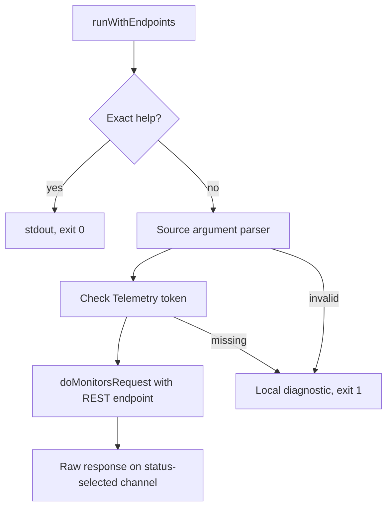

# Telemetry sources

## Commands and endpoint

[runWithEndpoints](../../cmd/bs/main.go) routes `bs sources list` and `bs sources get <id>` to the Telemetry REST input. `runWithAPI` preserves the Uptime injection interface and supplies the fixed production Telemetry REST host, `https://telemetry.betterstack.com`. Only tests inject another REST endpoint. No user setting overrides it. The SQL endpoint input has no active route.

| Command | Handler | GET path |
|---|---|---|
| `bs sources list` | `sourcesList` | `/api/v2/sources` |
| `bs sources get <id>` | `sourcesGet` | `/api/v2/sources/<escaped-id>` |

[Source handlers](../../cmd/bs/sources.go) read only `BETTERSTACK_TELEMETRY_API_TOKEN` through `telemetryTokenEnvVar`. They read it to redact local argument diagnostics, but validate arguments before reporting an unset or empty token. Invalid arguments and missing credentials exit 1 without HTTP access. No Uptime or legacy token fallback exists.

## Arguments

List accepts only space-separated `--page`, `--per-page`, and `--timeout` values. Pagination values contain ASCII decimal digits only. Page must be positive. Per-page must be from 1 through 50. Leading zeros remain unchanged in the query. Positive pages have no machine-integer ceiling. Empty, signed, whitespace, zero, non-digit, and over-limit per-page values fail locally. Every repeated occurrence is validated and preserved under `page` or `per_page`. Absent pagination flags send no default query value.

Get requires exactly one nonempty opaque Source ID. `url.PathEscape` escapes the whole ID as one path segment. The handler does not interpret URL-shaped IDs or require numeric IDs. Empty IDs count as positional arguments and cannot precede or follow another ID. Option-shaped targets are rejected.

Both commands default to a 30-second timeout. `--timeout <duration>` accepts a positive Go duration. Get accepts it before or after the ID. The last valid repeated timeout applies. Equals forms, unknown options, and unexpected positional arguments fail locally.

This local parser example produces `page=1&per_page=50` with a 30-second timeout:

```go
parsed, err := parseSourcesListArgs([]string{"--page", "1", "--per-page", "50"})
```

## Requests, responses, and help

Both handlers reuse the [Request executor](../uptime/requests.md), `doMonitorsRequest`. It sends exactly one bearer-authenticated GET with a timeout and disables redirects. It passes complete 2xx bodies unchanged to stdout and other HTTP bodies unchanged to stderr. It does not decode, format, redact, add a newline, retry, or follow pagination links. Transport, timeout, and body-read failures use token-redacted local diagnostics.

Source response `token` fields remain unchanged on both output channels. The CLI does not assign a meaning or permission to that field. [Help](../../cmd/bs/help.go) warns on both commands: “The output includes each source's `token` field. Treat it as a secret credential. Keep it private and do not paste it into shared logs or tickets.”

Exact source resource and command help returns before credentials or HTTP access. Root help lists sources. The resource usage gate recognizes sources and its list/get actions. Malformed source vectors return source-specific usage diagnostics.



[Source tests](../../cmd/bs/sources_test.go) and [routing tests](../../cmd/bs/main_test.go) use dummy tokens and loopback servers. The [test harness](../../cmd/bs/safety_test.go) clears inherited Telemetry, Uptime, and legacy API tokens and blocks non-loopback HTTP access. Tests cover separate endpoints, auth, validation, raw bodies, redirects, local failures, help, and secret warnings.

Related: [memory map](../mem-map.md), [terminology](../terminology.md), and [Uptime testing](../uptime/testing.md).
