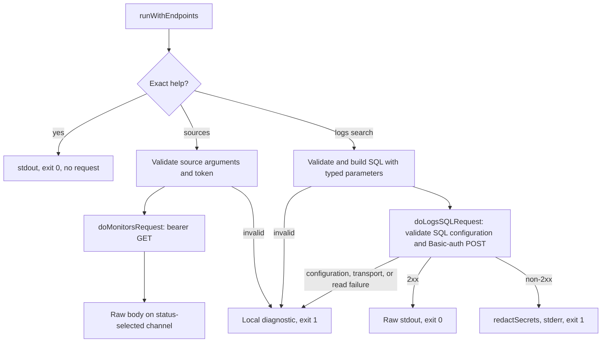

# Telemetry summary

The Telemetry domain exposes `bs sources list`, `bs sources get <id>`, and `bs logs search`.
`runWithAPI` supplies the fixed REST host and an empty SQL injection input to `runWithEndpoints`.
The Endpoint injection seam checks exact help before dispatching either request path.
Help returns 0 without credentials or requests. Unknown resources and actions return usage diagnostics with exit 1.
Sources: [routing](../../cmd/bs/main.go), `cmd/bs/main.go:13-67,74-103,113-152,179-190`.

## Separate request contracts

- [Sources](sources.md) use `BETTERSTACK_TELEMETRY_API_TOKEN` for bearer authentication at `https://telemetry.betterstack.com`.
  List validates repeatable decimal pagination. Get escapes one nonempty opaque Source ID as one path segment.
  Argument validation precedes the missing-token check. No Uptime or legacy token fallback exists.
  Sources: [handlers](../../cmd/bs/sources.go), `cmd/bs/sources.go:14-84,92-151`, and `cmd/bs/main.go:13,30-31`.
- Source handlers share `doMonitorsRequest` with the five Uptime handlers.
  It sends one timed GET, disables redirects, and writes complete 2xx bodies unchanged to stdout or other bodies unchanged to stderr.
  Local failures use token-redacted diagnostics. Source output includes secret `token` fields that must remain private.
  Sources: [requests](../../cmd/bs/monitors.go), `cmd/bs/monitors.go:81-135`, and [help](../../cmd/bs/help.go), `cmd/bs/help.go:80-120`.
- [Log search](logs.md) validates the full table identifier, flags, and time bounds before SQL configuration or HTTP access.
  `buildLogsSearchQuery` returns SQL and separate typed parameters from one captured time.
  Hot storage is the default. `--cold` adds one filtered cold branch with `UNION ALL`.
  Sources: [builder](../../cmd/bs/logs.go), `cmd/bs/logs.go:27-34,158-272`.
- SQL requires `BETTERSTACK_TELEMETRY_SQL_URL`, `BETTERSTACK_TELEMETRY_SQL_USERNAME`, and `BETTERSTACK_TELEMETRY_SQL_PASSWORD`.
  The SQL URL accepts approved HTTPS forms. SQL credentials never fall back to API tokens.
  `doLogsSQLRequest` sends one timed Basic-authenticated POST without redirects or retries.
  It writes complete 2xx bodies unchanged to stdout. Only non-2xx SQL bodies undergo Telemetry secret redaction before stderr and exit 1.
  Transport and body-read failures return fixed diagnostics without partial output.
  Sources: [executor and URL parser](../../cmd/bs/logs.go), `cmd/bs/logs.go:18-23,39-94,111-156`, and [redaction](../../cmd/bs/telemetry.go), `cmd/bs/telemetry.go:13-33`.

Both request paths default to 30 seconds and accept a positive `--timeout` duration.
Sources: `cmd/bs/monitors.go:18`, `cmd/bs/sources.go:54-84,92-129`, and `cmd/bs/logs.go:209-210,259-270`.

This local Go example builds the default hot query without credentials or requests:

```go
sql, params, err := buildLogsSearchQuery(
    []string{"--table", "t1_fake"},
    time.Unix(3600, 0),
)
```

The bounds bind as `param_from=0` and `param_to=3600000`.
Source: [default-query test](../../cmd/bs/logs_test.go), `cmd/bs/logs_test.go:545-570`.



[Tests](../uptime/testing.md) clear inherited API credentials and SQL configuration before installing the Loopback-only network guard.
The guard covers default and explicitly guarded HTTP transports, not arbitrary custom transports or direct connections.
Recording transports return in-memory responses without dialing. Route tests verify separate REST and SQL destinations.
Sources: [test safety](../../cmd/bs/safety_test.go), `cmd/bs/safety_test.go:1-25,50-137`, [REST routing](../../cmd/bs/main_test.go), `cmd/bs/main_test.go:26-35,298-340`, and [SQL routing](../../cmd/bs/logs_test.go), `cmd/bs/logs_test.go:62-104`.

Related: [system summary](../summary.md), [memory map](../mem-map.md), and [terminology](../terminology.md).
