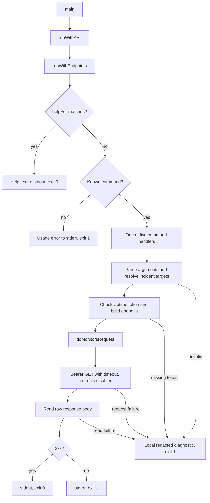

# Uptime summary

The [command package](../../cmd/bs/main.go) implements five read-only Uptime commands. `main` supplies the fixed production base URL and an HTTP client. `runWithAPI` accepts those dependencies and the stdout/stderr writers so tests can use local servers. It delegates to `runWithEndpoints`, which accepts distinct Uptime, Telemetry REST, and SQL endpoint inputs. Uptime and [source REST handlers](../telemetry/sources.md) are active. The SQL input remains unused. `helpFor` runs before command routing.



The monitors-list route in `runWithEndpoints` delegates to its handler with the remaining arguments and injected Uptime dependencies:

```go
if len(args) >= 2 && args[0] == "monitors" && args[1] == "list" {
	return monitorsList(args[2:], stdout, stderr, uptimeBaseURL, client)
}
```

[Commands](commands.md) maps every route to its endpoint and help boundary. [Requests](requests.md) defines the common output and credential contract. [Incidents](incidents.md) covers target and metadata rules. [Testing](testing.md) describes loopback-only checks. The [memory map](../mem-map.md) indexes the complete set.
